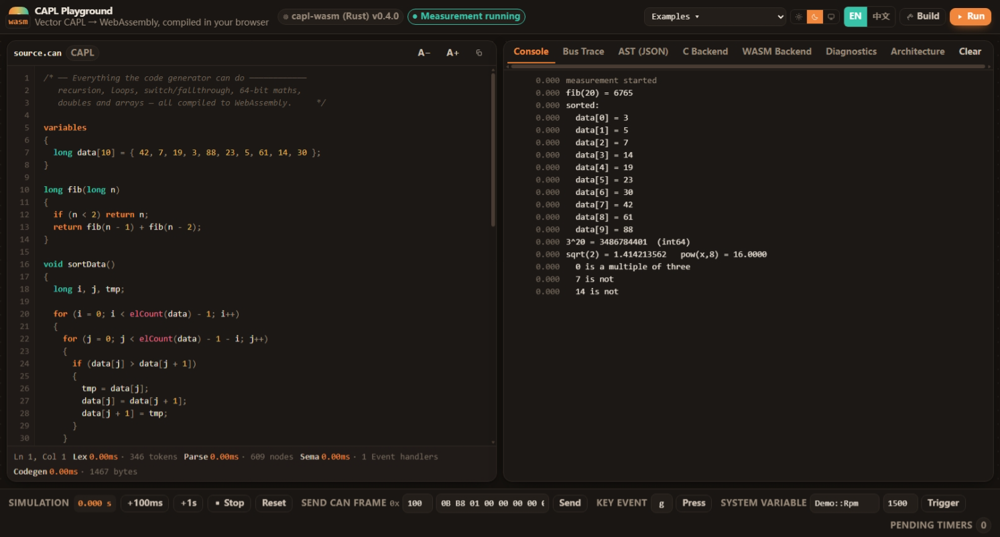

# CAPL 语言游乐场

[](https://github.com/oldrev/capl-playground/actions/workflows/deploy-pages.yml)
[](https://github.com/oldrev/capl-playground/actions)
[](https://github.com/oldrev/capl-playground/actions)
[](LICENSE-MIT)

一个在线的 **Vector CAPL**（CANoe/CANalyzer 节点语言）开发沙盒。
你可以在浏览器中编写 CAPL，观察它经过真正的编译流程，查看 JSON 格式的 AST、生成的 C 代码和 WebAssembly，然后在一个包含虚拟时间、定时器、CAN 总线和按键事件的微型测量环境中运行 WebAssembly。

整个过程无需向服务器发送代码：编译器直接在页面中运行。



```
source.can ─▶ 词法分析 ─▶ 语法分析 ─▶ AST ─▶ 语义分析 ─┬─▶ wasm 后端 ─▶ .wasm ─▶ 模拟器
                                                       ├─▶ C 后端    ─▶ .c
                                                       └─▶ AST 后端  ─▶ .json
```

## 仓库结构

```
src/                      playground UI（React + Vite + Tailwind v4）
  core/                   Rust WASM 桥接和仅供编辑器使用的语法 lexer
    driver.ts             capl-wasm 的前端契约
  runtime/sim.ts          模拟的 CANoe 测量环境（宿主导入）
  components/             编辑器、面板和架构页
rust/                     可复用的编译器核心 crate
  crates/capl-diag        span 和诊断集合
  crates/capl-lexer       扫描器
  crates/capl-ast         AST、类型格、visitor 和 serde JSON 导出
  crates/capl-parse       递归下降解析器
  crates/capl-sema        作用域、符号和类型
  crates/capl-codegen-wasm  wasm 模块写入器（LEB128 + section，无依赖）
  crates/capl-codegen-c   C99 写入器
  crates/capl-driver      阶段编排、Backend trait 和 `capl` CLI
  crates/capl-wasm        本页面使用的 wasm-bindgen 外观层
```

### Rust 编译器与 TypeScript UI

页面会在 React 启动前加载 `capl-wasm`，并在 `globalThis.__CAPL_CORE__` 上注册唯一的编译器实现；TypeScript 只负责编辑器、模拟宿主和展示层。

```bash
./rust/build-wasm.sh          # wasm-pack build → public/capl/capl_wasm.js
cargo run -p capl-driver -- node.can --emit=wat
cargo run -p capl-driver -- node.can --emit=wasm -o node.wasm
cargo test --workspace
```

### Rust 测试覆盖率与 CAPL fixture

编译器在 `rust/crates/capl-driver/tests/` 下提供驱动层集成测试，会让真实 CAPL 程序依次经过 Rust lexer、parser、语义分析、C 后端和 WebAssembly 后端。fixture 覆盖定时器和处理器、周期 CAN 消息、数组和函数、64 位及浮点表达式，以及无效输入诊断。

安装一次 [`cargo-llvm-cov`](https://github.com/taiki-e/cargo-llvm-cov)，然后运行：

```bash
cd rust
cargo llvm-cov --workspace --all-features --lcov --output-path coverage/lcov.info
cargo llvm-cov --workspace --all-features --html --open
```

在 Windows 上，`./rust/coverage.ps1` 会运行 LCOV 命令并打印摘要。CI 使用同一工具，并在 Rust 测试任务中生成 `rust/coverage/lcov.info`，随后上传为 `rust-coverage` artifact。原生覆盖率命令有意只测量可复用的编译器 crate；`capl-wasm` 外观层则通过浏览器构建和运行时 smoke test 覆盖。

## 生成的模块

wasm 后端手写二进制，包括 LEB128、section，以及一个与 WAT 列表同步输出字节的代码构建器。

```
0x0000  空指针保护
0x0040  write() 使用的可变参数整理区（32 个槽位 × 16 B）
0x0400  字符串池、全局变量、消息对象和函数静态变量
```

导入项（模块名为 `capl`，由宿主提供；这里是浏览器模拟器，也可以是 CANoe shim 或其他测试台）：

```
write(fmt, argc, args)   setTimer(id, ms)   setTimerCyclic(id, ms)
cancelTimer(id)          output(msgPtr)     timeNow() -> i32
random(n) -> i32         strlen(ptr) -> i32 pow/sin/cos
canOnline()              canOffline()       stopMeasurement()
```

导出项：`memory`、不可变全局变量 `__msgbuf`（事件消息对象地址）、`__init`、`__set_this`、`__set_fuel`、每个用户函数，以及每个事件处理器对应的函数（`on_start`、`on_timer_tick`、`on_message_0x100`、`on_key_103` 等）。

每个循环回边都会递减 fuel 计数器，归零时触发 trap，因此意外的 `while (1) {}` 不会冻结页面；模拟器会将其报告为运行时 trap。

## 支持的语言子集

支持 `variables{}` 块（也可在其中定义类型）、全局变量、`const`、数组和花括号初始化；`byte word dword qword int long int64 float double char`；带隐式和显式值的 **`enum`**，可直接用于 `switch` 标签；具有计算成员布局的 **`struct`**；多维数组、结构体数组及数组类型的结构体成员；消息对象的 `.id .dlc .can .byte(n) .word(n) .dword(n)` 和 `this`；`timer`/`msTimer`；事件 `preStart start stopMeasurement preStop timer message key sysvar envVar errorFrame busOff`（支持 `on message CAN2.0x100` 这类带通道匹配）；`if else while do for switch`（支持 fall-through）、`break continue return`；完整的 C 表达式语法，包括 `?:`、短路 `&&`/`||` 和复合赋值；支持递归和数组参数的用户函数；内建函数 `write`（printf 风格）、`output`、`elCount`、`timeNow`、`random`、`abs`、`min`、`max`、`sqrt`、`pow`、`sin`、`cos`、`floor`、`ceil`、`strlen`、`canOnline`、`canOffline`、`stopMeasurement`。

局部聚合类型在声明时由生成的 `__zero` 辅助函数清零，确保示例可复现。编译期常量（枚举成员、`const int N = 3`）会被折叠为立即数，不占用线性内存。

尚未实现：`includes{}`、数据库信号访问（`$Signal`）、测试模块、按值传递或返回聚合类型，以及整个结构体赋值（诊断信息会提示逐成员复制）。

## UI

* 浅色 / 深色 / **系统**主题，记忆于 `localStorage`
* English / 简体中文，根据 `navigator.language` 自动检测
* 带精确 span 的诊断信息，可点击，并在编辑器 gutter 中同步显示
* 状态栏显示各阶段耗时、token/节点数量和模块大小
* 模拟栏：虚拟时钟、`+100 ms` / `+1 s`、帧注入、按键事件和待处理定时器检查器

快捷键：`Ctrl`/`⌘` + `Enter` 构建并运行。

## 免责声明

CAPL Playground 是独立的实验性兼容性和教学项目。它不受 Vector Informatik GmbH 赞助、认可或隶属，也不是从 Vector、CANoe、CANalyzer 或任何其他 Vector 产品派生而来。“Vector”、“CAPL”、“CANoe”和“CANalyzer”是其各自所有者的名称和商标，本项目仅用它们标识希望互操作的语言或行为。

本项目不包含 Vector 软件、专有数据库、文档或测试资产，也不声称实现官方 CAPL 工具链。

使用本项目的风险由你自行承担。你应自行确认适用于所使用源代码、规范、示例、商标、逆向工程活动和部署环境的许可证及条款。本声明仅供参考，不构成法律建议。

## 许可证

版权所有 (c) 2026 Wei Li

本项目采用 MIT 与 Apache License 2.0 双重许可。你可以根据自己的需要，选择以下任一许可证使用本项目：

* [MIT 许可证](LICENSE-MIT)
* [Apache License 2.0](LICENSE-APACHE)

除非你另有明确声明，任何有意提交并纳入本项目的贡献也将按照上述双重许可发布，且不附加其他条款或条件。

## 编译器架构参考

编译器架构参考了 DMD 前端的设计。

## 当前语法覆盖

当前版本已经支持具名 `struct`、字段和字段数组、数组参数，以及基于线性内存地址的数组/结构体函数边界。原生 CLI 支持 `includes { "file.can" }`，先按源文件目录解析，再使用 `CAPL_INCLUDE_PATH` 中的目录；浏览器编译没有文件系统访问，因此暂不解析 include 文件。

结构体布局、聚合参数、include 缺失和循环 include 都有 parser、语义分析、C/WASM 后端及 driver 集成测试。仍未实现的特性见主 README 的 TODO 和 [CAPL 语言参考](docs/CAPL_LANGUAGE.md)。
